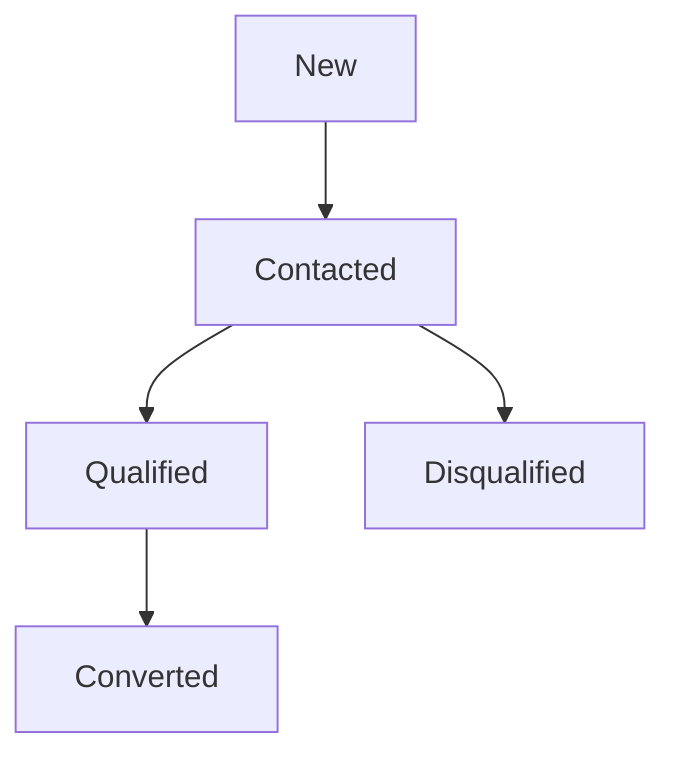
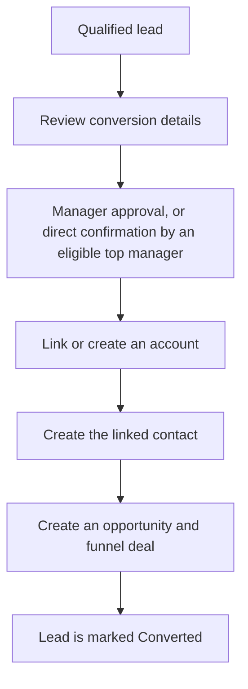

# Leads and conversion

Capture prospects, qualify them, and convert the right leads.

**New to these terms?** Read the [terminology reference](https://jienweng.gitbook.io/q-app/reference/terminology#lead).

## On this page

* [Create a lead](#creating-a-lead)
* [Understand statuses](#lead-statuses)
* [Convert a lead](#converting-a-lead)

---

## What is a Lead?

A **Lead** represents an unverified inbound expression of interest (e.g., from a web form, event booth, partner referral, or cold outreach). It serves as a staging area to qualify prospects without cluttering your core accounts and active sales pipeline.

---

## Creating a Lead




#### Open Leads

Navigate to **CRM → Leads** in the left sidebar.




#### Start a new lead

Click the **+ New Lead** button in the top right corner.




#### Enter prospect details

Fill in the lead information:

* **Name**: The prospect’s contact name.
* **Company Name**: The prospective organization name.
* **Email**: Required valid address; it becomes the contact email during conversion.
* **Phone**: Optional contact number.
* **Lead Source**: Where the lead originated (e.g., *Website, Referral, Event, Cold Outreach*).
* **Status**: Review the initial status. Ownership is assigned to the creating member; it is not an owner selector in this form.

Add follow-up context through the lead’s activity controls after creation. The current create form does not include Estimated Value or Notes fields.




#### Create the lead

Click **Create Lead**.




---

## The Lead Lifecycle

**Read the diagram:** a lead moves through outreach and qualification before conversion. A lead can also be disqualified when it is not worth pursuing. The detail page does not provide a Restore to Contacted action.

### Lead Statuses

* **`New`**: Newly received lead awaiting initial review.
* **`Contacted`**: Outreach has commenced (email sent, call made, meeting scheduled).
* **`Qualified`**: The prospect has verified need, budget, and authority.
* **`Disqualified`**: The prospect is not a fit for your services.

### Handling Disqualification
When marking a lead as **Disqualified**:




#### Enter a disqualification reason

Use **Disqualify** and type a non-empty **Reason**, such as “No budget for this year.” The current dialog uses a text input, not a structured reason dropdown.




#### Record context

Confirm the disqualification. The typed reason is saved with the lead and recorded in its activity history.




#### Understand the available follow-up actions

The lead detail page locks status controls for Disqualified and Converted records. There is no dedicated disqualification restore action. **Undo** in the Leads list’s deletion toast only reverses deletion, requires Delete leads permission and record access, and preserves the prior status. It does not restore a Disqualified lead to Contacted.

**Converted** is set only by the approved conversion workflow. The edit/status actions cannot be used to bypass conversion approval. Ask your administrator or support contact to review a disqualified lead that needs renewed follow-up.




---

## Converting a lead

Qualify the lead before converting as a team practice. Conversion is available for active, non-Converted leads and does not enforce Qualified status. Disqualified leads cannot be converted. When ready for a commercial proposal, convert it using the **Conversion Wizard**. Add a valid email to the lead before converting; the new contact requires one.

**Result:** the converted lead links to the customer records and sales pursuit. Review account matching and currency before confirming; the same lead cannot be converted twice.

### Approval before conversion

The conversion form saves a request with the selected account and conversion details. No linked records are created while it is pending, and the lead remains unconverted. The eligible reporting manager reviews it under **Sales → Approvals → Needs my review**, filtered to **Lead conversions**. The requester can track or cancel it in **My requests**. Rejection requires a reason and leaves the lead available for correction and resubmission.

A manager with **Approve lead conversions** permission and no manager above them can convert directly. A manager with a superior must request approval, just like other users. Missing reporting configuration is not an exemption. See [Shared manager approval policy](https://jienweng.gitbook.io/q-app/reference/permissions-and-approvals#shared-manager-approval-policy).

Approval rechecks saved details, record access and current lead data. If the lead changes after submission, cancel and resubmit with the updated details. Duplicate pending requests and duplicate conversions are prevented. The requester must remain active with **Convert leads** and access to the lead and selected account. The reviewer must have **Approve lead conversions** and access to the lead and selected account. A failed conversion rolls back both linked records and the approval decision, leaving the request pending.

### Step-by-step conversion




#### Open the lead

Open the Lead detail page.




#### Start conversion

Click the **Convert Lead** button in the top action bar.




#### Review the linked records

You will be redirected to the full-page conversion wizard:

* **Account Section**:
  * **Link Existing Account**: The wizard scans your database for matching company names. If a match is found, you can link to the existing Account.
  * **Create New Account**: If no match exists, select `Create New Account`. Specify the Account Type (*Client* or *Reseller*), Account Code, and Address.
* **Contact Section**:
  * Automatically creates a new Contact record pre-filled with the lead's name, email, and phone number, associated with the Account.
* **Opportunity & Funnel Section**:
  * **Opportunity Name**: Defaults to `[Company Name] opportunity` (customizable).
  * **Expected Close Date**: Set the estimated closing target date.
  * The deal is automatically seeded into the sales funnel at the initial stage **`0e` (Identified)**.




#### Convert the lead

Click **Submit conversion**. The server either queues it for approval or performs direct conversion when you are eligible. Check **My requests** for the approval result.





**Review before converting.** Conversion creates linked records and marks the lead Converted. You cannot convert the same lead again.


## Continue

* [Accounts & contacts](03-accounts-and-contacts.md)
* [Troubleshooting](help-center/troubleshooting.md)
* [Back to start](https://jienweng.gitbook.io/q-app)
