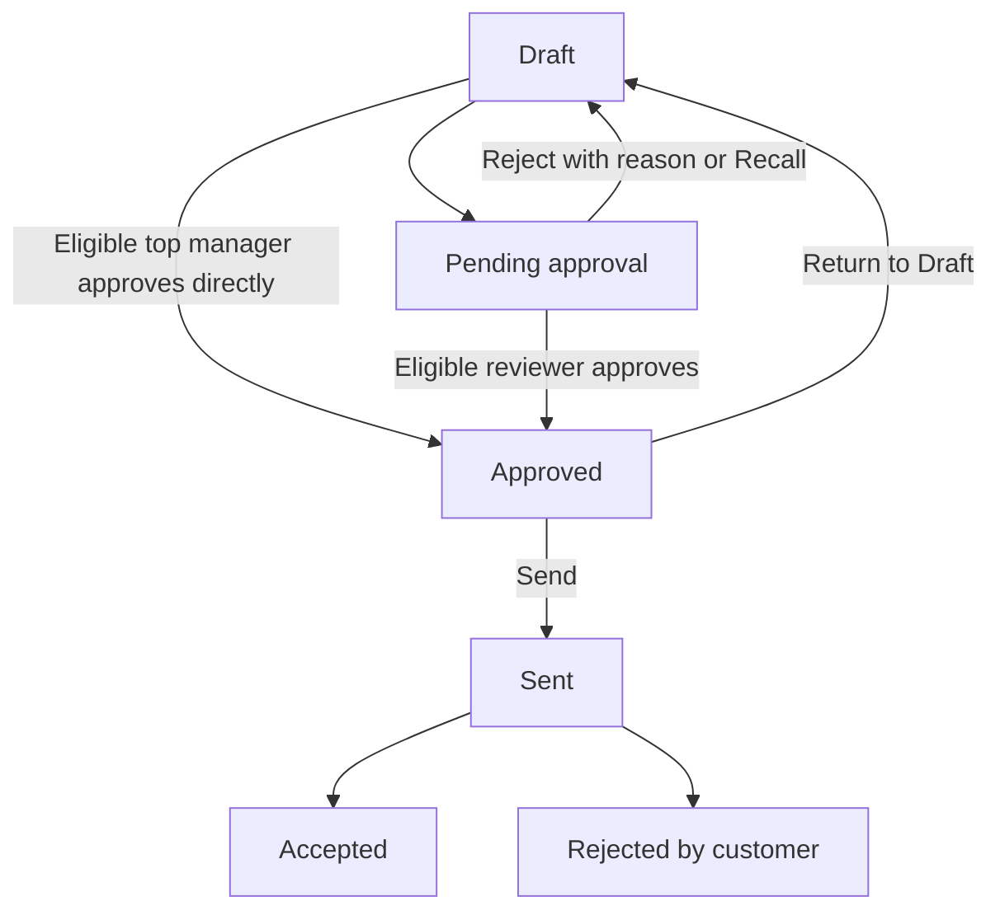

# Quotations and revisions

Prepare an offer, get approval, and manage customer changes.

**New to these terms?** Read the [terminology reference](https://jienweng.gitbook.io/q-app/reference/terminology#quotation).

## On this page

* [Create a quote](#creating-a-quotation)
* [Check approval status](#the-quotation-lifecycle)
* [Actions by status](#actions-by-status)
* [Create a revision](#managing-revisions)
* [Print a PDF](#exporting-client-pdfs)

---

## What is a Quotation?

A **Quotation** is the formal commercial and legal proposal presented to the customer. It contains itemized pricing, tax breakdowns, delivery schedules, and payment terms.

---

## Creating a Quotation




#### Start a quotation

Open the target deal in **Sales → Funnel** and click **+ New Quotation** (or navigate to **Sales → Quotations** and click **+ New Quotation**).




#### Check linked records

Choose the Funnel when starting from the Quotations list. Its customer records are linked, and its currency supplies the default. Review the supported quotation currency before pricing.




### Bill To when quoting through a reseller

Keep the Opportunity and Funnel under the **end user**. In the quotation, select the company that receives and pays the quotation in **Bill To**, then choose an **Attention** contact from that company.

For example, when Uniti sells to MCMC, keep the Funnel under **MCMC**, select **Uniti Office** as Bill To, and select Uniti's contact. Quandatics bills Uniti; Uniti bills MCMC. Different quotations in the same Funnel may be addressed to different resellers, so you do not need a separate Funnel for every reseller quote.

The Bill To picker includes accounts you can access and shared reseller accounts in your current entity. Selecting a reseller does not transfer the Funnel or expose another salesperson's deals. For a direct sale, keep **End-user account (same as funnel)**.

Saving a new quotation or its Draft captures the billing company, address, phone and selected contact. Issued quotations use that saved snapshot in the PDF. To correct an issued quotation, follow the available return-to-Draft or revision workflow. Duplicating or revising a quotation copies its billing snapshot into the new Draft for review.

For five resellers pursuing the same end-user deal, keep one Funnel and prepare a quotation for each reseller. Select Bill To first; changing it clears the old Attention choice and loads contacts for the new company. Shared reseller access is limited to the current entity.

**Address check:** there is no separate quotation-address field. Correct the selected Bill To account address before saving the Draft, then check Preview. A blank address is not automatically filled from another company or from the end user. Issued quotations retain their billing snapshot; use the appropriate Draft or revision workflow for corrections.

### Check defaults before sending

Review payment terms, delivery notes, the recipient contact, currency, and tax before submitting the quote. Defaults help you prepare a draft; do not assume that every default becomes immutable at creation.


**Sending freezes the tax snapshot.** Draft labels can use the selected tax setting. When the quotation is sent, the applicable rate is captured so the sent quote no longer tracks later tax-setting changes.


---

## Adding Line Items and Product Pricing




#### Add a line item

In the **Line Items** section, click **+ Add Line Item**.




#### Choose a catalog product

**Select from Product Catalog**:

* Choose a product by name. Selection fills its description, standard unit price and unit of measure. Review price and currency; selection does not apply an exchange rate.




#### Add custom items if needed

**Custom Line Items**:

* You can manually type custom service descriptions, deliverable milestones, or bespoke project scopes.




#### Review pricing

**Configure Pricing**:

* **Quantity**: Number of units/days/hours.
* **Unit Price**: Base price per unit in the quotation currency.
* **Discount**: Optional amount in quotation currency. A header discount is also available.
* **Tax Rate**: Applies tenant tax setting (e.g., 0% Exempt, 6%, 8% SST).




#### Check the totals

The system computes subtotal, total discount, tax amount, and final total in real time.




---

## Document Templates

The preview resolves the template from account and organization configuration, with a default fallback. Built-in layouts include Default, QAR, CC, Quandatics Malaysia and Quandatics Academy. The quotation editor has no per-quote Standard/Academy selector. Ask your administrator to review the configured template if branding is wrong.

---

## The Quotation Lifecycle

**Revision is a separate record:** an eligible historical quotation creates a new Draft copy. The original Sent or Accepted quote does not change back to Draft when you revise it.

### `Draft`
The sales rep drafts and edits line items, notes, and pricing.

### `Pending Approval`
A draft must be approved before it can be sent:

* Click **Submit for Approval**, or **Approve quotation** when you have quotation-approval permission and no reporting manager above you. Direct approval moves Draft to Approved without a pending request.
* The quote is locked against further edits and reviewed on the quotation by the first active eligible manager in the submitter’s reporting line (the funnel owner is the fallback for legacy requests without submission audit data) with **Approve quotations** permission. Only that eligible manager may approve or reject it. The same quotation requests also appear in **Sales → Approvals**, alongside funnel-stage requests.
* To make changes before approval, use **Recall to Draft** with **Edit quotations** permission and access to the record. Recall clears the approval assignment and metadata, keeps the same quotation number, and allows editing and resubmitting. If approval has already completed, use **Return to Draft** instead.
* If the account owner changes while approval is pending, the quotation returns to Draft with an explanation. The new owner must resubmit it.

### `Approved`
The eligible reporting manager approves the queued quotation, or an eligible top manager approves their Draft directly. A member with send permission can then record sending it. To change an Approved quotation, use **Return to Draft**, then edit and resubmit. Approval is required again. Sending records the action; it does not send an email notification.

### `Sent`
Once delivered to the customer via email or formal meeting, use **Send** to record sending.

### `Accepted` or `Rejected`

* **Accepted**: The customer accepts the proposal. *(Note: Customer acceptance records commercial agreement; it does not automatically move the Funnel stage).*
* **Rejected**: The customer rejected the proposal.

---

## Actions by status

In this guide, **live quotation** means a quotation that has not been deleted; it does not mean Sent or Accepted. An **eligible top manager** means an active member with the matching approval permission and no reporting manager above them, rather than a particular job title.

Each action also requires record access and its permission. **Edit quotations** allows editing Drafts, submitting them, recalling Pending Approval quotations, and returning Approved quotations to Draft. **Create quotations** allows duplicating live quotations and creating eligible revisions. **Approve quotations** is limited to the current eligible reviewer. **Send quotations** and **Accept quotations** are separate permissions.

| Current status | Available lifecycle actions | Editing and revision |
| --- | --- | --- |
| Draft | Submit for Approval, or direct approval by an eligible top manager. | Edit this record; no revision action. |
| Pending Approval | Eligible reviewer approves or rejects with a reason; an authorized editor can Recall to Draft. | Read-only until recalled or rejected to Draft. Edit and resubmit with the same number. No revision action for a live record. |
| Approved | Send, or Return to Draft. | Read-only until returned to Draft. Returning clears approval; resubmit after editing. No revision action for a live record. |
| Sent | Record customer acceptance or rejection. | Read-only; create a separate Draft revision with Create quotations permission. |
| Accepted or customer Rejected | No further lifecycle decision on this record. | Read-only; an eligible revision starts a separate Draft. |
| Expired or Void | No manual lifecycle action offered by the current action menu. | Eligible historical states for a separate Draft revision. |

**Send checks:** the funnel must still be open and the quotation must not be past **Valid until**. If an Approved quotation has lapsed, return it to Draft, update its validity, and obtain approval again. **Send** records sending; deliver the document to the customer through your usual channel.

**Acceptance checks:** only a Sent quotation on an open funnel can be accepted, and its validity date must not have passed. Only one live quotation per funnel can be Accepted. Creating a revision of an Accepted quote does not replace that acceptance; the current workflow blocks accepting another quote while the earlier live quote remains Accepted. There is currently no supersede or cancel-acceptance action. The original Accepted quotation cannot be returned to Draft or deleted. A revision can therefore be prepared, but its acceptance cannot be completed through the current workflow while the original remains Accepted. Sending and acceptance are also blocked once the Funnel is Won. Ask support to review the case; do not treat a prepared revision as accepted.

**Other actions:** **Set Primary** is shown for non-primary Sent or Accepted quotations with Edit quotations permission. It selects the quotation used for linked funnel values; it does not approve it. Deletion requires **Delete quotations**, is subject to record/reference checks, and is blocked for Accepted quotations. Deletion is not a customer-rejection or approval-rejection decision.

**PDF checks:** Preview and exporting do not approve or send the quotation. Sending captures the tax rate and recomputes stored totals using the current tax configuration. The Send action reads the current tax rate and tax-inclusive setting, recalculates header and line totals, and stores that snapshot. It does not compare the recalculated figures with the approved figures or request fresh approval if they differ. For example, if the configured tax rate changes between approval and sending, the Sent quotation can have different tax and total amounts. Review the final PDF's tax and totals before sharing.

See [Documents, actions, and approval](https://jienweng.gitbook.io/q-app/reference/documents-and-actions) for version-specific examples.

## Duplicate a quotation

Use **Duplicate quotation** on a live quotation with **Create quotations** permission and access to the record. Duplication is available in any live status, including Draft and Pending Approval.

* The copy belongs to the **same funnel only**. There is no destination funnel or entity selector.
* It starts as a new, non-primary Draft with the next quotation version number. The source keeps its content, status, and history.
* Pricing, line items, notes, delivery and payment terms are copied. Approval, sending and customer acceptance metadata are cleared.
* The quotation date resets to today and **Valid until** is cleared. Review dates, contacts, pricing and tax before submitting the copy for its own approval.
* Duplication creates an independent quotation; **Create revision** additionally links the new Draft to its source as a revision.
* Deleted quotations cannot be duplicated. Eligible deleted non-Draft history can still be used to create a revision.

### Copying between entities

Cross-entity quotation import is not currently available. **Duplicate quotation** cannot copy a QM quotation into QA or into another Funnel. Create the destination quotation in its own entity and Funnel until an import workflow is released.

## Delete quotations and preserve numbering

**Issued quotation numbers are never reused after deletion, even for a Draft.** Deletion hides the quotation through a soft delete while retaining its original number and audit history. It does not reset a counter, renumber remaining quotations, or fill gaps.

The running number belongs to the funnel. Every quotation in that funnel shares that running number and has a distinct version suffix. New quotations, duplicates and revisions use the highest version ever issued in the funnel plus one, including deleted versions.

| Situation | Result |
| --- | --- |
| Delete `Q10001-2`, with version 2 the highest issued version. | The next quotation in the same funnel is `Q10001-3`; `Q10001-2` stays reserved. |
| Delete an earlier version while `Q10001-3` exists. | The next quotation is `Q10001-4`; earlier gaps remain. |
| Delete every quotation in a funnel after issuing versions 1–3. | A later quotation in that funnel retains running number `0001` and starts at version 4: `Q10001-4`. |
| Create the first quotation in a different funnel. | It takes the entity's next running number; the deleted funnel's running number is not recycled. |
| Recall Pending Approval or return Approved to Draft. | The same record keeps its existing number and version; editing and resubmitting do not allocate another number. |
| Duplicate a quotation. | The new Draft takes the next version in the same funnel; the source keeps its number. |

These examples use the current quotation format. Existing funnels retain their established reference format.

Skipping numbers avoids ambiguity when an earlier PDF was emailed, downloaded, referenced in an approval, or retained by a customer. A visible gap is preferable to two different documents bearing the same reference.

Deletion requires **Delete quotations** permission and access to the record. The current server allows deletion of Draft, Pending Approval, Approved, Sent, Rejected, Expired and Void quotations, provided no live project references them. **Accepted quotations cannot be deleted.** Deleting a primary quotation selects another eligible live quotation or clears the primary reference and updates the linked funnel value. Use Recall or Return to Draft when the intention is to edit an existing quotation rather than remove it.

## Managing Revisions

Customers often request scope adjustments or discount updates after a quote is sent.

**To create a revision:**




#### Open the source quotation

Open the existing sent or accepted quotation.




#### Create a revision

Use the revision action available on the quotation. Sent, Accepted, Rejected, Expired, and Void quotations are eligible historical states.




#### Review the new draft

The system executes the following:

* **Preserves Source**: The source quotation keeps its status and history; its content remains read-only.
* **Creates Revision**: A new linked draft copy is created. Use its displayed quotation number when referring to the revision.
* The new revision has no approver, approval date, sending date, or customer acceptance. It starts non-primary. Review copied items, terms, dates, and tax before submitting it through its own approval flow.




---


**Approved or pending quote?** An approved quote can be returned to Draft, edited, and submitted for approval again. A pending quote can be recalled to Draft, edited, and resubmitted. The revision action is not available on live Pending Approval or Approved quotes.


## Exporting Client PDFs

Open **Preview** on the quotation:

* Review the resolved template, billing recipient, items, totals and terms. Layout content varies by template.
* Use **Download PDF** to generate and save the PDF. Generation errors appear beside the controls.
* **Print** opens the browser print dialog; choose **Save as PDF** if needed. Inspect the saved file before sharing.

## Project-code context

When the linked funnel is at Commit (4A) or Closed Won, quotation lists and details show its clickable **Project code**, plus a **Cross-deal reference** only when the Salesforce reference differs. This information is available without the Projects module. Duplicating a quotation within the same funnel keeps that relationship; it does not allocate a different project identity. The code fields are CRM context, not a change to the quotation's running number or PDF template.

If Projects is enabled, the linked delivery project can be found through its explicit quotation/funnel relationship or matching funnel code, subject to matching account and project-view access. Creating a project reuses the existing funnel code; it does not silently replace it with a newly generated number.

### Open a project code

Active project codes are clickable: open one to see its connected sales records. Codes appear only for linked funnels at Commit (4A) or Closed Won; earlier-stage historical values stay stored but hidden. The **Sales → Project Codes** directory and the **Project Codes** group in global search are available without the Projects module. See [Project codes across sales records](04-opportunities-and-funnel.md#project-codes-across-sales-records).

## Continue

* [Payment milestones](06-payment-milestones.md)
* [Troubleshooting](help-center/troubleshooting.md)
* [Back to start](https://jienweng.gitbook.io/q-app)
