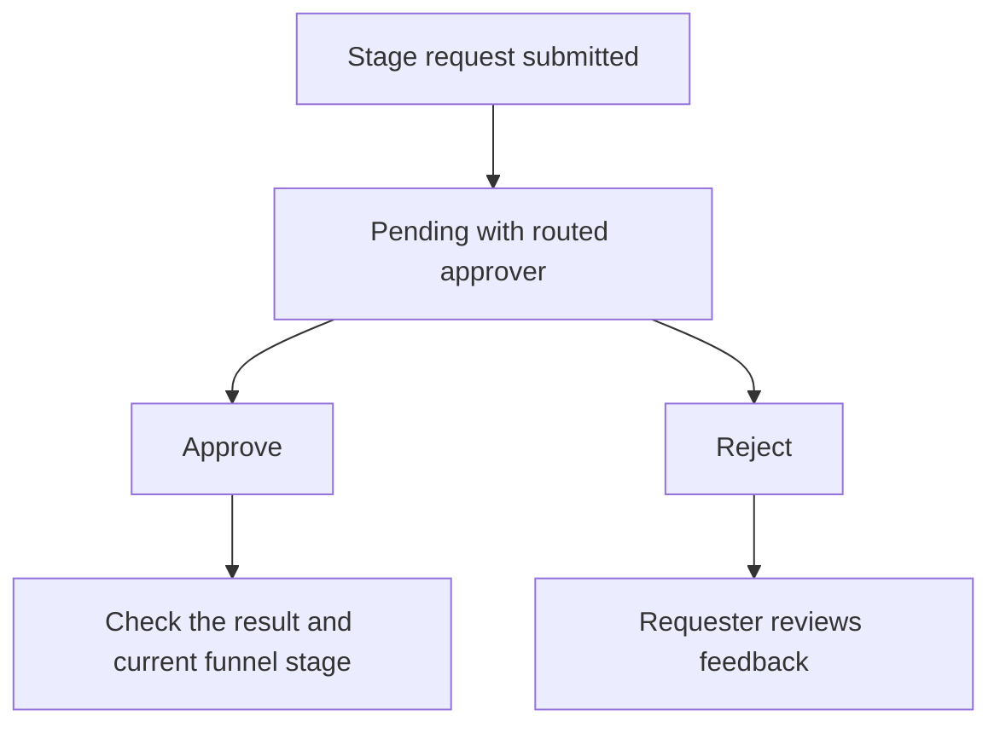

# Approvals inbox

Use **Sales → Approvals** to review quotation, funnel-stage and lead-conversion requests. **Needs my review** contains pending requests routed to you; **My requests** tracks your submissions. Both use one queue with a selected-request review panel.

**New to these terms?** Read the [terminology reference](https://jienweng.gitbook.io/q-app/reference/terminology#stage-gate).

## On this page

* [What appears in each tab](#what-appears-in-each-tab)
* [Find your requests](#find-your-requests)
* [Review and decide](#review-and-decide)
* [Follow up after a decision](#follow-up-after-a-decision)


**Who can use this page?** People with stage-change, stage-approval, quotation-update, quotation-approval, lead-conversion or lead-conversion-approval permissions can participate. Quotation and lead-conversion requests also require their record-view permissions and ownership/team access. Requests route to the first active manager in the requester’s reporting line with the matching permission: **Approve lead conversions**, **Approve quotations**, or **Approve stage advances**. Quotation and lead-conversion reviewers must remain eligible and have record access. Stage requests are listed by stored approver assignment; decisions require that assignment and current manager eligibility to match. Requesters cannot approve or reject their own queued request; they can cancel or recall it where authorized. Permissions from all assigned roles count. Platform superadmins retain an operational override.


## What appears in each tab

| Request type | Needs my review | My requests |
| --- | --- | --- |
| **Lead conversion approvals** | Pending conversions routed to you. Expand **Submitted conversion details**, use **View lead**, then **Approve** or **Reject**. | Your submitted requests and their status. Use **Cancel request** while pending. |
| **Quotation approvals** | Pending quotations routed to you. Use **View quotation**, then **Approve** or **Reject**. | Your latest submission per quotation and its current status. Use **Recall to Draft** while pending when authorized. |
| **Funnel-stage approvals** | Pending stage changes assigned to you. Review the stage change, reason and attachments, then **Approve** or **Reject**. | Your stage requests and their status. Use **Cancel request** while pending. |

Quotation and lead-conversion requests are shown within ownership/team access. Funnel-stage requests include pending requests assigned to the manager. These are not organization-wide queues for ordinary managers. The queue has one pagination control across all request types. Approved, rejected and cancelled requests leave **Needs my review**; follow your submissions in **My requests**. A rejected quotation returns to **Draft**, so its review panel shows the current quotation status and rejection reason.

A member with the matching approval permission and no reporting manager can proceed directly. **Direct actions do not create a pending request in Needs my review.** Managers with a superior must request approval. See [Managers' own actions](#managers-own-actions).

## Find your requests




#### Open Approvals

Open **Sales → Approvals**.




#### Review Needs my review

Choose **Needs my review** for pending requests routed to you.




#### Track My requests

Choose **My requests** to track requests you submitted.




#### Navigate requests

Use **Previous** and **Next** to navigate one queue of 25 requests per page. Requests default to **Oldest first**, across all three types. Search request information or requester names, filter by type, or choose **Newest first**. Counts reflect accessible requests matching those filters.




An empty Needs my review tab means no pending requests are currently routed to you; it does not show every request in the organization.

### Review layout and consistent controls

On desktop, select a queue row to open its review panel beside the list. On smaller screens, the request opens in a full-width panel with **Back to requests**. The review explains **What approval does**, shows submitted business context, and keeps decision controls outside the scrolling details area. Record navigation appears on the left of the action bar and decisions on the right, wrapping when necessary on narrow screens.

All pending workflows display **Awaiting approval** using the same warning colour. Approved and rejected states use the shared CRM status colours. Quotations continue to show their current document status; rejection or recall returns them to Draft. Confirmation dialogs retain each workflow's rules: quotation and lead-conversion rejection reasons are required, while a stage decision note remains optional. Use **How approvals work** for reporting-line guidance.

Search applies to the request's available business information and requester. The queue's submission order preserves timestamp precision across types. Legacy pending quotations without submission audit data use their last update time for ordering only; their submission date remains unavailable rather than guessed. After a decision, the current filtered queue refreshes and the next available request is selected. If a queue read fails, retry before making a decision.

## Review and decide




#### Check the request type and identity

Select the request and check its type, requester and linked record. For a quotation, check its number/version, Bill To, total and terms. For a lead conversion, review the saved account/contact and sales-pursuit details. For a stage request, check the current and requested stages. **What approval does** explains the effect for that request.




#### Review supporting context

Read the submitted context and open the linked record when needed. For stage requests, expand **Attachments** when supporting files are available. A PDF or attachment alone is not an approval decision.




#### Choose a decision

Choose the request-specific **Approve** action or **Reject**.




#### Add a decision note

Quotation and lead-conversion rejection require a reason. Stage decision notes are optional; explain what the requester should correct when rejecting.




#### Confirm and read the result

Confirm the decision and read the result message.




**Example — a stage request:**

**Read the diagram:** approval processes the requested stage change. Rejection leaves the requester to review the feedback and correct or reconsider the request. The app rechecks the current stage and required information before applying approval. If the original transition is no longer current, the request becomes obsolete and the stage does not move.

## Follow up after a decision

* **Quotation approved:** verify the quotation is Approved. Sending and customer acceptance are separate actions.
* **Lead conversion approved:** open the lead and verify its Converted status and linked records.
* **Stage request approved:** open the Funnel and verify the resulting stage. An obsolete request does not move the stage.
* **Rejected:** review the decision note, resolve the issue, and submit a new request if needed.
* **No longer needed:** requesters can cancel their pending request where the action is available.
* **Reporting manager changed:** quotation and lead-conversion review follows the current eligible manager. A stale stage request needs cancellation and resubmission because its stored reviewer assignment must also match.
* **Account owner changed:** pending stage requests are cancelled and pending quotations return to Draft. The new owner can resubmit them. This is not a general cancellation rule for every lead-conversion request.
* **No eligible manager:** ask your administrator to configure the reporting line and approval permissions. Submission does not route to an unrelated approver.

## KIV reopen requests

KIV-to-open moves use the same manager approval policy. Eligible top managers can reopen directly; other users submit a request. Approval applies the reopen only if the original transition is still current. See [KIV reopening](04-opportunities-and-funnel.md#kiv-keep-in-view).

## Quotation approvals

Every quotation requires approval before sending. **Needs my review**, filtered to **Quotations**, lists pending quotations routed to you as the currently eligible manager and within your record access. Quotation routing follows reporting-line and approval-permission changes, matching the checks performed when deciding. Review panels show quotation number, funnel, end-user customer, Bill To, total, requester and submission date. Use **View quotation** to review the full details, then **Approve** or **Reject** here or on the quotation itself. Rejection requires a reason and returns the quotation to Draft.

The eligible approver is the first active manager in the submitter's reporting line (the funnel owner is the fallback for legacy requests without submission audit data) with **Approve quotations** permission. The existing quotation actions recheck permissions, record access, current manager eligibility and status when deciding. These actions record audit events but do not send email notifications.

**My requests**, filtered to **Quotations**, shows the latest submission for each quotation you submitted, using the actual submission audit actor rather than the account owner. Review panels show the current quotation status and rejection reason where present. Pending quotations can be **Recalled to Draft** by eligible requesters. Recalled, rejected and approved quotations leave Needs my review. This view is not a complete history of every resubmission. Legacy pending quotations without submission audit data can appear in Needs my review with an unknown requester/date; they are not attributed to a guessed requester.

See [Quotation lifecycle](05-quotations-and-revisions.md#the-quotation-lifecycle).

## Lead conversion approvals

Review lead name, company, requester and saved conversion details before deciding. **Approve** performs conversion and marks the request approved in one transaction. **Reject** requires a reason and leaves the lead unconverted. Requesters can cancel pending requests in **My requests**, correct the lead or conversion details, and submit again. The submitted details include the contact, existing or new account, company code, account type, billing address, opportunity, funnel and expected close date. No account, contact, opportunity or funnel is created while the conversion request is pending.

## Managers' own actions

Across all three workflows, a member with the matching approval permission can proceed directly only when they have no reporting manager above them. Managers with a superior require approval. Ordinary sales users never gain direct approval merely because their manager is missing. Missing/inactive reporting profiles and an ineligible upline block the action until configured. Platform superadmins retain their operational override.

If your own request is already pending and you become eligible for direct action, cancel the lead-conversion request or recall the quotation before taking its direct action. A direct stage move automatically cancels older pending stage requests; a separate cancellation is not required.

## When the usual reviewer is unavailable

There is no delegated or proxy-approval button. The eligible reviewer must act with their own account; sending a PDF to someone for advice does not change who can approve in the CRM. Ask an administrator to review reporting lines and permissions if a reviewer cannot act. A member who submits a quotation for a colleague becomes its submitter for routing purposes. See [Approval routing](https://jienweng.gitbook.io/q-app/reference/permissions-and-approvals#can-someone-approve-on-behalf-of-another-manager).

## Related document rules

See [Documents, actions, and approval](https://jienweng.gitbook.io/q-app/reference/documents-and-actions) for the difference between stage approval, quotation approval, customer acceptance, and supporting attachments.

## Continue

* [Opportunities & sales funnel](04-opportunities-and-funnel.md)
* [Quotations & revisions](05-quotations-and-revisions.md)
* [Troubleshooting](help-center/troubleshooting.md)
