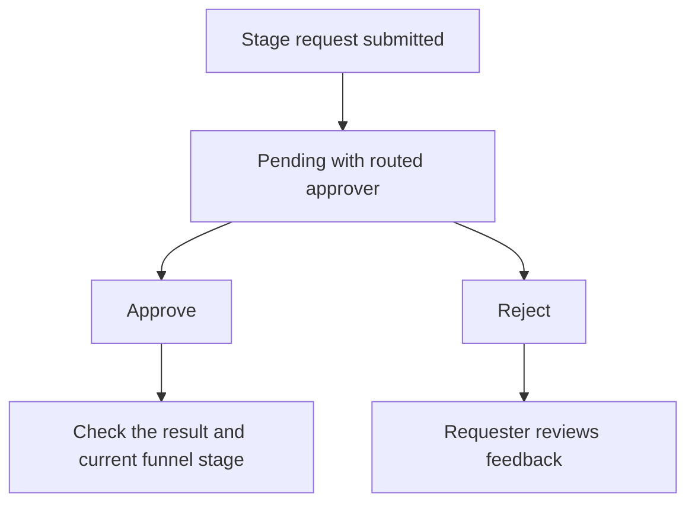

# Approvals inbox

Use **Sales → Approvals** to review quotation, funnel-stage and lead-conversion requests. Both **Incoming** and **My requests** contain separate, labelled sections for the three workflows.

**New to these terms?** Read the [terminology reference](https://jienweng.gitbook.io/q-app/reference/terminology#stage-gate).

## On this page

* [What appears in each tab](#what-appears-in-each-tab)
* [Find your requests](#find-your-requests)
* [Review and decide](#review-and-decide)
* [Follow up after a decision](#follow-up-after-a-decision)


**Who can use this page?** People with stage-change, stage-approval, quotation-update, quotation-approval, lead-conversion or lead-conversion-approval permissions can participate. Quotation and lead-conversion cards also require their record-view permissions and ownership/team access. Requests route to the first active manager in the requester’s reporting line with the matching permission: **Approve lead conversions**, **Approve quotations**, or **Approve stage advances**. Quotation and lead-conversion reviewers must remain eligible and have record access. Stage requests are listed by stored approver assignment; decisions require that assignment and current manager eligibility to match. Requesters cannot approve or reject their own queued request; they can cancel or recall it where authorized. Permissions from all assigned roles count. Platform superadmins retain an operational override.


## What appears in each tab

| Section | Incoming | My requests |
| --- | --- | --- |
| **Lead conversion approvals** | Pending conversions routed to you. Expand **Submitted conversion details**, use **View lead**, then **Approve** or **Reject**. | Your submitted requests and their status. Use **Cancel request** while pending. |
| **Quotation approvals** | Pending quotations routed to you. Use **View quotation**, then **Approve** or **Reject**. | Your latest submission per quotation and its current status. Use **Recall to Draft** while pending when authorized. |
| **Funnel-stage approvals** | Pending stage changes assigned to you. Review the stage change, reason and attachments, then **Approve** or **Reject**. | Your stage requests and their status. Use **Cancel request** while pending. |

Quotation and lead-conversion sections show eligible requests within ownership/team access. The funnel-stage section shows pending requests assigned to the manager. These are not organization-wide queues for ordinary managers. Each section has independent pagination. Approved, rejected and cancelled requests leave **Incoming**; follow your submissions in **My requests**. A rejected quotation returns to **Draft**, so its card shows the current quotation status and rejection reason.

A member with the matching approval permission and no reporting manager can proceed directly. **Direct actions do not create a pending request in Incoming.** Managers with a superior must request approval. See [Managers' own actions](#managers-own-actions).

## Find your requests




#### Open Approvals

Open **Sales → Approvals**.




#### Review Incoming

Choose **Incoming** for pending requests routed to you.




#### Track My requests

Choose **My requests** to track requests you submitted.




#### Navigate requests

Each section has its own **Previous** and **Next** controls, with 25 records per page. **Review quotations** opens the full quotation list.




An empty Incoming tab means no pending requests are currently routed to you; it does not show every request in the organization.

## Review and decide




#### Check the stage request

Find the request and check the funnel name, requester, current stage, and requested target stage. Approval authorizes that exact transition, not a quotation or a supporting file.




#### Review supporting context

Review the supporting context. Expand **Attachments** when supporting files are available.




#### Choose a decision

Choose **Approve** or **Reject**.




#### Add a decision note

Add a decision note. The stage-approval dialog makes this optional, but a clear reason helps the requester follow up.




#### Confirm and read the result

Confirm the decision and read the result message.




**Read the diagram:** approval processes the requested stage change. Rejection leaves the requester to review the feedback and correct or reconsider the request. The app rechecks the current stage and required information before applying approval. If the original transition is no longer current, the request becomes obsolete and the stage does not move.

## Follow up after a decision

* **Approved:** open the funnel and verify the resulting stage. Read any message about an obsolete request before assuming the stage changed.
* **Rejected:** review the decision note, resolve the issue, and submit a new request if needed.
* **No longer needed:** requesters can cancel their pending request where the action is available.
* **Reporting manager changed:** cancel and resubmit a stale pending request so it routes to the current eligible manager.
* **Account owner changed:** the pending request is cancelled automatically; the new owner can submit a new request.
* **No eligible manager:** ask your administrator to configure the reporting line and approval permissions. Submission does not route to an unrelated approver.

## KIV reopen requests

KIV-to-open moves use the same manager approval policy. Eligible top managers can reopen directly; other users submit a request. Approval applies the reopen only if the original transition is still current. See [KIV reopening](04-opportunities-and-funnel.md#kiv-keep-in-view).

## Quotation approvals

Every quotation requires approval before sending. **Incoming → Quotation approvals** lists pending quotations routed to you as the currently eligible manager and within your record access. Quotation routing follows reporting-line and approval-permission changes, matching the checks performed when deciding. Cards show quotation number, funnel, end-user customer, Bill To, total, requester and submission date. Use **View quotation** to review the full details, then **Approve** or **Reject** here or on the quotation itself. Rejection requires a reason and returns the quotation to Draft.

The eligible approver is the first active manager in the submitter's reporting line (the funnel owner is the fallback for legacy requests without submission audit data) with **Approve quotations** permission. The existing quotation actions recheck permissions, record access, current manager eligibility and status when deciding. These actions record audit events but do not send email notifications.

**My requests → Quotation approvals** shows the latest submission for each quotation you submitted, using the actual submission audit actor rather than the account owner. Cards show the current quotation status and rejection reason where present. Pending quotations can be **Recalled to Draft** by eligible requesters. Recalled, rejected and approved quotations leave Incoming. This section is not a complete history of every resubmission. Legacy pending quotations without submission audit data can appear in Incoming with an unknown requester/date; they are not attributed to a guessed requester.

See [Quotation lifecycle](05-quotations-and-revisions.md#the-quotation-lifecycle).

## Lead conversion approvals

Review lead name, company, requester and saved conversion details before deciding. **Approve** performs conversion and marks the request approved in one transaction. **Reject** requires a reason and leaves the lead unconverted. Requesters can cancel pending requests in **My requests**, correct the lead or conversion details, and submit again. The submitted details include the contact, existing or new account, company code, account type, billing address, opportunity, funnel and expected close date. No account, contact, opportunity or funnel is created while the conversion request is pending.

## Managers' own actions

Across all three workflows, a member with the matching approval permission can proceed directly only when they have no reporting manager above them. Managers with a superior require approval. Ordinary sales users never gain direct approval merely because their manager is missing. Missing/inactive reporting profiles and an ineligible upline block the action until configured. Platform superadmins retain their operational override.

If your own request is already pending and you become eligible for direct action, cancel the lead-conversion request or recall the quotation before taking its direct action. A direct stage move automatically cancels older pending stage requests; a separate cancellation is not required.

## Related document rules

See [Documents, actions, and approval](https://jienweng.gitbook.io/q-app/reference/documents-and-actions) for the difference between stage approval, quotation approval, customer acceptance, and supporting attachments.

## Continue

* [Opportunities & sales funnel](04-opportunities-and-funnel.md)
* [Quotations & revisions](05-quotations-and-revisions.md)
* [Troubleshooting](help-center/troubleshooting.md)
